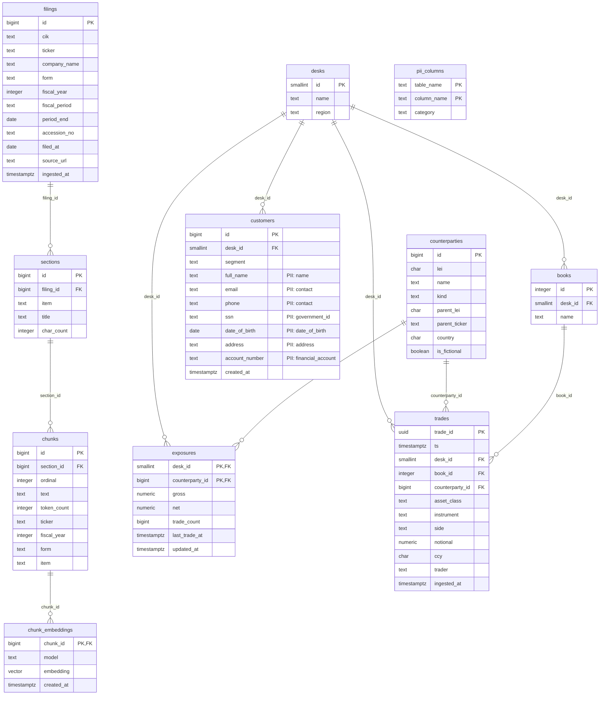

# Data model

Generated from the live schema by `make er-diagram` (scripts/db-test.sh). Do not edit by hand.
Columns marked `PII` are listed in the `pii_columns` table; `readonly_analyst` cannot read them.

